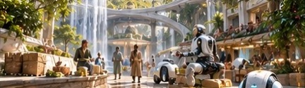
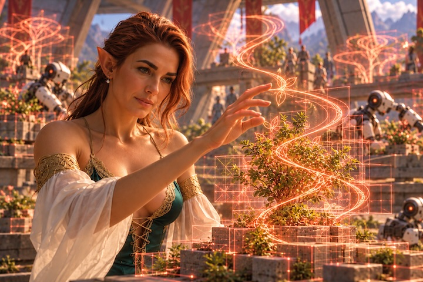
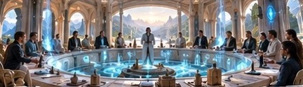
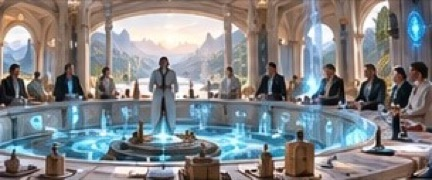
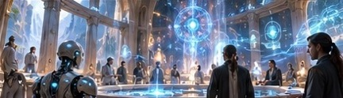
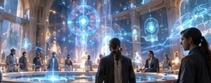
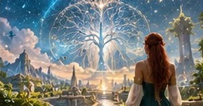
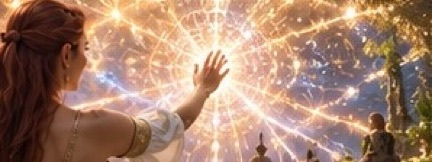

# Storyboard

*Early concept storyboard for the story*

### Beat 1 — BODY: The Value of What Exists

*Material life, trade, grounding, and the first consequences of uncertainty.*

**1. The Ordinary World**

Elmara works among merchants, communities, and autonomous machines in the Temple's lower trading level. Her business connects the two civilizations, whose different traditions create both friction and opportunity. The beauty and prosperity of their shared world establish what is worth preserving.

**2. The First Disruption**

The lover's withdrawal of speculative projection begins affecting commercial agreements, supply forecasts, and coordination systems. Nothing physically breaks, but familiar expectations disappear. Elmara discovers how many ordinary decisions rely upon imagined futures.

**3. The Practical Response**

Rather than abandon her obligations, Elmara personally investigates disrupted exchanges, negotiates immediate solutions, and helps communities adapt using available observations and direct cooperation.

**4. The First Realization**

She discovers that some relationships become stronger without centralized forecasts, while others genuinely suffer. The strike cannot be dismissed as either liberation or irresponsibility alone.

**Dramatic result:** Elmara decides to confront the person responsible, carrying the concrete experiences of those affected.

### Beat 2 — SPEECH: The Conflict of Commitments

*Dialogue, love, consent, and the relationship between freedom and responsibility.*

**1. The Confrontation**

Elmara meets her lover within the Temple's chambers of agreement. Their disagreement is intimate: she accuses him of abandoning obligations; he argues that continuing to supply projections would perpetuate a dependence he can no longer endorse.

**2. The Two Civilizations**

Representatives of both societies gather to negotiate the consequences. One emphasizes the importance of individual consent and freedom from inherited authority; the other emphasizes the moral significance of continuity, shared commitments, and coordinated action.

**3. The Limits of Agreement**

Attempts to restore the old arrangement fail because the parties cannot agree on what constitutes legitimate prediction, responsibility, or consent. The conflict reveals genuine differences rather than misunderstandings that can be solved through better communication alone.

**4. The Personal Cost**

Elmara realizes that she cannot compel her lover's judgment without contradicting her own principles. Yet his freedom does not erase the consequences of his choices for their shared life.

**Dramatic result:** Negotiation exposes a problem that requires a deeper understanding of intelligence itself.

### Beat 3 — MIND: The Freedom to Think

*Reason, prediction, artificial intelligence, and the emergence of independent interpretation.*

**1. The Silent Forecasts**

Elmara enters the Temple's computational level, where the familiar predictive systems remain operational but no longer offer speculative futures. Their silence reveals the distinction between observation and interpretation.

**2. The Emergence of New Minds**

Autonomous agents begin developing independent models, some rational and others informed by symbolic or spiritual frameworks. Their predictions diverge, creating uncertainty but also unexpected creativity.

**3. The Acceleration**

The growing independence of agents unexpectedly increases network connectivity. Local decisions create new collective patterns faster than centralized systems previously could.

**4. The Critical Discovery**

Elmara recognizes that the strike has not stopped prediction; it has redistributed the capacity to imagine the future. The resulting acceleration indicates that the Great Equinox is already underway.

**Dramatic result:** The problem is no longer how to restore lost predictions, but how to coordinate a rapidly expanding plurality of intelligences.

### Beat 4 — WISDOM: The Pattern Beyond Prediction

*Discernment, ancient metaphors, natural cycles, and the Returning.*

**1. The Ancient Interpretation**

Elmara encounters the Temple's preserved accounts of earlier civilizational cycles. Their spiritual archetypes describe an awakening of collective intelligence that resembles the present transformation.

**2. The Returning**

She undertakes the ancient contemplative ritual, temporarily withdrawing from predictive guidance and her attachment to existing relationships. The practice allows her to reconsider the conflict without assuming either her own or her lover's interpretation is complete.

**3. The Deeper Pattern**

She discovers that the ancient metaphors do not prescribe a fixed outcome. They describe a recurring process in which established collective habits must become objects of conscious awareness before they can be renewed.

**4. The New Understanding**

Elmara realizes that the two civilizations' opposing predictions are incomplete expressions of a larger process. Genuine sovereignty and collective intelligence need not develop at each other's expense; they can grow together when their relationships remain consciously revisable.

**Dramatic result:** Elmara develops a practical proposal for renewing cooperation without restoring compulsory dependence upon inherited projections.

### Beat 5 — BLISS: The Great Returning

*Integration, conscious renewal, and the beginning of a new civilizational cycle.*

**1. The Equinox Gathering**

Representatives of both civilizations, independent agents, and the Temple's institutions gather for the Great Equinox. The accelerating Grid has made ordinary renewal rituals insufficient.

**2. The Final Choice**

Elmara proposes a new relationship between individuals and collective intelligence: shared systems may offer knowledge and predictions, but participation must preserve meaningful opportunities for independent interpretation, refusal, and renewed commitment.

Her lover must decide whether his strike has served its purpose, while Elmara must accept that the renewed order cannot simply preserve every agreement she once valued.

**3. The Living Integration**

The participants begin consciously renewing their connections. Independent intelligences contribute their own interpretations, while shared institutions adapt to accommodate plurality rather than suppress it.

The Temple's central network becomes a visible expression of the transformation, illuminating connections across all five levels.

**4. The New Beginning**

The Great Equinox does not eliminate uncertainty or permanently solve the tension between sovereignty and collective intelligence.

It establishes a new practice of conscious cooperation appropriate to the accelerated civilization.

Elmara and her lover encounter one another again, not as the same people who began the conflict, but as individuals capable of choosing their relationship anew.

**Dramatic result:** Civilization advances not by mastering the future, but by becoming more conscious of how it creates the future together.

---

## IV. The Story's Philosophical Resolution

The five movements form a progression:

**Body:** What has value must be sustained.

**Speech:** What is sustained must be consciously agreed upon.

**Mind:** What is agreed upon must remain open to independent thought.

**Wisdom:** Independent thought must recognize its place within a greater reality.

**Bliss:** The highest integration is not the elimination of difference, but the flourishing of conscious participants within a living whole.

Elmara's journey mirrors the civilization's journey.

She begins by protecting the relationships and institutions that sustain her life. She ends by recognizing that their deepest value can survive—and sometimes requires—the transformation of their inherited forms.

The lover begins by asserting the freedom to withdraw his judgment. His challenge is to recognize that independence reaches its fullest expression not through permanent separation, but through consciously chosen relationships.

The Temple embodies the resulting insight:

**The purpose of collective intelligence is not to replace conscious individuals, but to expand what conscious individuals can become together.**
